<p align="center"></p>

# finance-agent

Your bank accounts, categorised and explained on your own Mac. Read-only, local-first, with a local AI that never sees the internet.

This repo holds no real financial data: development, the demo and every screenshot use synthetic data.

## Install in one line

```sh
curl -fsSL https://raw.githubusercontent.com/esharif20/finance-agent/main/install.sh | sh
```

macOS on Apple Silicon. The script is short, needs no sudo, can be run again, and never touches your data: it installs [uv](https://docs.astral.sh/uv/) if missing (checked against a pinned SHA-256), installs `fa`, and offers Ollama.

Try it first on synthetic data, with no setup:

```sh
fa demo            # opens the full app on a fictional household; Ctrl-C deletes it
```

Then set up for real:

```sh
fa setup           # database key, bank, local AI, optional cloud, background jobs
```

`fa setup` resumes where it stopped. The bank step uses [Lunch Flow](https://www.lunchflow.app/), a paid subscription billed by Lunch Flow, which reads your banks through UK open banking; in Lunch Flow you add a SimpleFIN destination and paste its setup token into a hidden prompt.

## What it does

- Imports every transaction from your banks (Lunch Flow sync or CSV exports) into an encrypted ledger.
- Categorises them with rules, your corrections and a local model, and asks you only about what it is unsure of.
- Shows months, categories, subscriptions and cash flow, and flags price rises, trials and spending spikes.
- Answers questions in plain English. Every figure comes from the ledger, never from the model.

## Privacy promises

- **Read-only.** It can never move money: no payments, no transfers.
- **Your Mac only.** The ledger is SQLCipher-encrypted with its key in the Keychain. The only hosts it talks to are Lunch Flow (to fetch your transactions) and, only if you opt in per conversation, Google Gemini through a privacy gateway that sends placeholders, never your figures, on a paid-tier key, with a £9 monthly cap.
- **No telemetry.** No analytics, no third-party tracing. Logs never contain amounts, descriptions or account details.
- **Yours to remove.** `fa uninstall` keeps your data; `fa uninstall --purge` deletes it after you type a confirmation.

## Commands

| Command | What it does |
| --- | --- |
| `fa` | Starts the app if needed and opens it, after the banner and a one-line status |
| `fa setup` | Guided setup; safe to re-run |
| `fa demo [--persona N] [--list]` | The synthetic demo, locally |
| `fa status` | A terminal dashboard: last sync, accounts, this month, review count, subscriptions, cloud, model, backup |
| `fa month [YYYY-MM]` | A month by Category, with bars |
| `fa subs` | Subscriptions, active and likely, the monthly total and the AI tools cap |
| `fa doctor` | Checks keys (by length), encryption, Ollama and models, the bank host pin, launchd jobs, disk and backups, each with a fix |
| `fa models [install\|remove]` | Local models with this project's benchmark results and a recommendation for this Mac (also `fa brain`, `fa ai`) |
| `fa keys [set\|remove\|check]` | Keychain items by presence and length; the database key is read-only |
| `fa bank [status\|sync\|add\|manage\|disconnect]` | Lunch Flow: connect, add a bank, manage billing, check connections |

`fa --help` lists the rest (`sync`, `import`, `backup`, `restore` and more), grouped.

## Demo

`fa demo` runs the public demo's backend on this Mac over six fictional households. The hosted demo link arrives with the Vercel deployment (#299).

## Uninstall

```sh
fa uninstall           # removes the app and its background jobs; your data stays
fa uninstall --purge   # also deletes the ledger and the app's Keychain items (asks first)
```

## Development

### Run the checks locally

Requires [uv](https://docs.astral.sh/uv/).

```
uv sync
uv run ruff check .
uv run pyright
uv run lint-imports
uv run pytest
uv run python scripts/fixture_guard.py
gitleaks git . --no-banner --redact   # if gitleaks is installed
```

CI (`.github/workflows/ci.yml`, job `checks`) runs the same commands on every PR.

### Local model (optional)

Category suggestions and the Assistant use local models through
[Ollama](https://ollama.com), on `localhost:11434` only. Nothing is downloaded
unless you ask: `fa models` compares them on this Mac, and
`fa models install` pulls the recommended one plus `nomic-embed-text`.

Without it the app keeps to Corrections and rules, and `/api/local-model`
reports `off`. Ollama loads the model when it is asked and unloads it about a
minute later. `uv run fa forget-embeddings` deletes every stored Merchant
vector; they are rebuilt from your Transactions when needed.

### Importing

```
uv run fa import export1.csv export2.csv
```

A file with any bad row is refused whole and listed with its line numbers; the
other files still import. A file that no Importer recognises stops the whole
batch, and the error names it. Exit status:

| Code | Meaning |
| --- | --- |
| 0 | Every file imported (or was already known) |
| 1 | Nothing imported |
| 2 | Some files imported, others refused |
