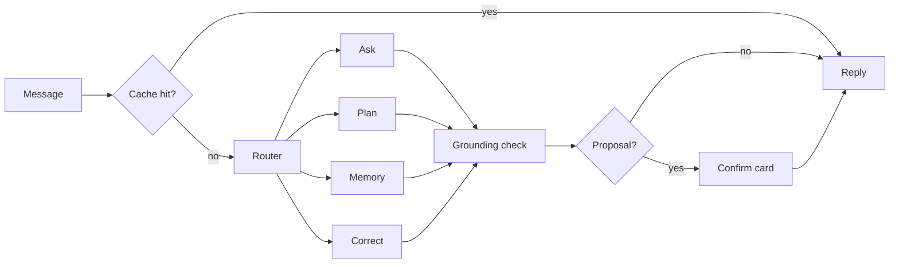

# AI design

Status: draft for review. Decisions: ADRs 0005, 0007–0013.

## Principle

The LLM is never the source of financial truth. The Intelligence Engine computes; the Assistant explains (ADR 0007).

## The Assistant

One LangGraph graph (ADR 0008):

| Sub-graph | Does | Tools |
| --- | --- | --- |
| Ask | Answers questions, explains Insights | `spending_summary`, `category_trend`, `list_insights`, `explain_insight`, `list_subscriptions`, `goal_status` |
| Plan | Allocation Plans, what-if simulations, trade-offs | `allocation_plan`, `simulate_purchase`, `goal_status`, `forecast_cashflow` |
| Memory | Elicits preferences, proposes Memories, re-checks conflicts | `list_memories`, `propose_memory` |
| Correct | Proposes Corrections (recategorise, mark transfer) | `find_transactions`, `propose_correction` |

Rules:

- Tools are read-only, Pydantic-typed and allowlisted per sub-graph. The only writes are Proposals, which do nothing until the user confirms.
- Tool results are aggregates, at most 20 rows, each with an evidence ID. Descriptions are marked as data, truncated to 60 characters, instruction-like text stripped.
- **Grounding check**: every £ figure, percentage and date in a reply must match a value from a tool result in that turn. Fails → regenerate once → deterministic fallback. Conventions (`assistant/grounding.py`, #137):
  - **Sign is exact.** "£40" is +£40 and matches only a positive value; "-£40" matches only a negative one. Tools report aggregates (money out, spending, Category totals, trends) as positive figures, so "you spent £40" fits them. A Transaction row is signed as the Bank has it (spending negative), so the graph (#139), when it turns a Spending row into `ToolValue`s, also gives its positive outflow. A signed figure that can go either way (net, a balance) is never given unsigned, so "you saved £40" can't pass on a net of -£40.
  - **Periods in words count as dates.** "March" must match the one tool month or date in March. "Last month" and "this month" are read against today; "last Tuesday" and a bare "Tuesday" must name a tool date within the six days either side. "3 March" with no year grounds only when exactly one tool date has that day and month.
  - **Every other number fails closed.** A whole number is a count and must equal a tool count, including digits in a Merchant name or a year standing alone. Figures in words, superscripts, fractions and other non-digit numerals never ground. Digits from other scripts (full-width, Arabic-Indic) are read as their value.
- Graph checkpoints live in the encrypted database. No LangSmith, no external tracing; CI egress test.
- **The graph (#139, `assistant/graph.py`).** The Router is one model call answering one word; anything else goes to Ask, the read-only sub-graph. Each sub-graph offers only its allowlisted tools, for at most 3 rounds of up to 4 calls; a refused call (another sub-graph's tool, bad arguments, another user's Transaction) comes back to the model as a fixed error, never its text. Tool results become `ToolValue`s by `assistant/values.py`: money signed as the tool gives it, a Spending Transaction row also as its positive outflow, `YYYY-MM` as a month, ISO dates as dates, whole numbers as counts; ids, flags and `{"data": ...}` text are never figures. The regeneration is offered no tools. A Proposal pauses the graph (`interrupt`) on a confirm card; the chat API resumes it with the user's decision, or the card is answered at `/api/proposals/{id}`. The checkpointed state holds the message, reply and route, never tool results.
- **Streaming.** The chat API streams a reply (server-sent events) only after the grounding check, so no unchecked figure reaches the screen; the `meta` event says which path answered (`local_model`, `deterministic`, later `cache`).

## Models

`ChatModel` interface with adapters: Ollama now, cloud later through the gateway. Model choice is benchmark-driven (see `ML_EVALUATIONS.md`). Candidates: `qwen3.5:9b` and one ~4B model. Note: community reports describe a qwen3.5 tool-call printing bug in some Ollama versions; the benchmark must catch it.

Routing per request: cache → local model → cloud only with per-conversation opt-in → deterministic tables. The UI always shows which path answered.

## Context engineering

Each turn's context is assembled, never accumulated:

| Slot | Contents | Budget |
| --- | --- | --- |
| System | Role, rules, tool schemas for the routed sub-graph only | fixed |
| Memories | Relevant confirmed Memories, selected by type and tag in SQL | ≤ 800 tokens |
| Conversation | Last few turns of this session | ≤ 1,500 tokens |
| Session summary | Short summary of recent sessions | ≤ 300 tokens |
| Tool results | This turn's results | ≤ 2,500 tokens |
| Knowledge | Cited guidance passages (when relevant) | ≤ 600 tokens |

Financial facts never enter context except as this turn's tool results: digits in earlier replies are masked in the conversation slot. Memories enter as quoted `{"data": ...}`, sanitised like bank text. Tokens are counted as 4 characters until the benchmark (#143) needs the model's tokenizer.

## Memory

Five stores: financial facts (never memorised, always recomputed), Memories (confirmed preferences, goals, constraints), conversation (session only), session summaries (90 days), feedback (kept).

A Memory exists only through a confirmed Proposal. It carries provenance (turn, date, the user's words), a type and a review date. Patterns in spending become Insights, never Memories. When behaviour contradicts a Memory, the Assistant asks.

## Answer cache

Keyed by (intent, tool calls with arguments, Ledger version), stored encrypted. Embedding similarity only maps wording to intent, never returns a cached answer (ADR 0010).

As built (#140, `ledger/answer_cache.py`): the key is a SHA-256 of the canonical JSON of (intent, tool calls with arguments, Ledger version, today's date); the date is there so "last month" is never read against another day. The intent is the routed sub-graph for now; no embedding is used. Only Ask answers that passed grounding after a single round of tool calls are stored, so those calls are everything the answer read. The graph looks the key up as soon as the model has chosen that round's calls, so a hit skips the tools, the answer generation and grounding; the reply's `path` is `cache`, and it carries the evidence IDs stored with the answer (ADR 0007). Deterministic fallbacks and Proposals are never cached. Storing drops rows of older Ledger versions, and a confirmed or deleted Memory clears the user's cache.

## Privacy gateway

Separate module, no database access. Placeholders replace figures, merchants and personal values; only allowlisted fields leave; per-conversation opt-in; every payload logged and viewable; replies validated before placeholders are filled locally; hard £9 monthly cap shared with the aggregator (ADR 0011, ADR 0013).

Notes (#124) are left out by default. Transaction rows carry no note text; notes are read only through the Ledger's `note` methods (`/api/notes`). Any context builder or export that could feed the gateway (the Assistant tools, #136) takes `exclude_notes: bool = True` and includes notes only when the user opts in for that one question.

## Intelligence Engine

**Detectors** (pure functions, Hypothesis-tested): recurring payments, price increases, Category spikes against personal baseline, unused subscriptions, upcoming renewals, cash-flow shortfall risk, life changes (change-point on income and essentials).

**Ranking**: impact × confidence × relevance, then a feasibility filter against Memories and constraints. Baseline to beat: rank by £ impact alone.

**Forecasting**: recurring payments from their schedule; discretionary spending per Category via exponential smoothing (ETS) with prediction intervals; cash flow combines both.

**Allocation Plans**: the Plan sub-graph gathers constraints and priorities as Memory Proposals; a linear program (`scipy.optimize`, OR-Tools only if needed) splits income with constraints as hard limits and weights from learned preferences; compared with a 50/30/20 baseline; explained with trade-offs.

**Knowledge base**: a small, user-approved set of guidance documents (MoneyHelper, gov.uk), stored with source URL, fetch date and version, embedded locally (Ollama embeddings + `sqlite-vec`). Cited when used; never supplies figures.

## Learning about the user

Layered, each step shipped only if it beats the previous one on evaluations:

1. Supervised categorisation from Corrections.
2. Personal baselines (seasonal, payday cycle).
3. Beta-Bernoulli relevance per Insight type and Category. As built (#150): `engine.insights` runs the detectors over the Ledger's GBP Spending (rows needing an FX rate left out; cancelled and not-a-subscription Merchants `stopped`), keeps what was raised in the 90 days up to the last row, and stores it idempotently (`ledger.insights`). The feed (`GET /api/insights`) ranks by impact × confidence × relevance, then drops any Insight whose Merchant or Category shares a word with a constraint Memory's tag. Only thumbs-up, thumbs-down and dismissals move the posterior; listing never does.
4. Weekly worth-it / regret review. As built (#152): `engine.briefing` picks 3 discretionary Transactions a week (Spending from the 28 days before the week, never Income, Transfers, Refunds, Fees or a Merchant with a schedule or registry entry, and never one answered in another week), ordered by SHA-256 of user id, week and Transaction id, so a week's list is stable. Answers are feedback (`regret_answer`), never Memories. The weekly briefing (`GET /api/briefing`) adds the top 3 ranked Insights, the forecast band for the week's month and the next payday (`engine.forecast`), and upcoming renewals; it says "insufficient" for a part without enough history, never a made-up figure.
5. Pairwise "which would you cut" questions: Bradley-Terry with active learning.
6. Thompson-sampling contextual bandit for what to suggest and when (from ~50 ratings).
7. Change-point detection resets baselines after confirmed life changes.

Not planned: full reinforcement learning (insufficient data), fine-tuning on real data (ADR 0009). LoRA via MLX only on synthetic tool-calling data if the benchmark shows a gap.

New model versions run in shadow, compared on the most recent month, promoted only if better, with one-click rollback via the model registry.
