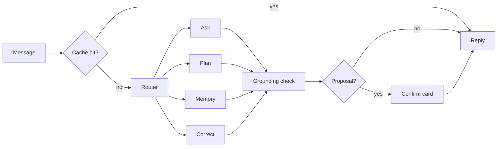

# AI design

Status: draft for review. Decisions: ADRs 0005, 0007–0013.

## Principle

The LLM is never the source of financial truth. The Intelligence Engine computes; the Assistant explains (ADR 0007).

## The Assistant

One LangGraph graph (ADR 0008):

| Sub-graph | Does | Tools |
| --- | --- | --- |
| Ask | Answers questions, explains Insights | `spending_summary`, `category_trend`, `category_detail`, `list_insights`, `explain_insight`, `list_subscriptions`, `goal_status` |
| Plan | Allocation Plans, what-if simulations, trade-offs | `allocation_plan`, `simulate_purchase`, `goal_status`, `forecast_cashflow` |
| Memory | Elicits preferences, proposes Memories, re-checks conflicts | `list_memories`, `propose_memory` |
| Correct | Proposes Corrections (recategorise, mark transfer) | `find_transactions`, `propose_correction` |

Rules:

- Tools are read-only, Pydantic-typed and allowlisted per sub-graph. The only writes are Proposals, which do nothing until the user confirms.
- Tool results are aggregates, at most 20 rows, each with an evidence ID. Descriptions are marked as data, truncated to 60 characters, instruction-like text stripped.
- **Grounding check**: every £ figure, percentage and date in a reply must match a value from a tool result in that turn. Fails → regenerate once → deterministic fallback. Conventions (`assistant/grounding.py`, #137):
  - **Sign is exact.** "£40" is +£40 and matches only a positive value; "-£40" matches only a negative one. Tools report aggregates (money out, spending, Category totals, trends) as positive figures, so "you spent £40" fits them. A Transaction row is signed as the Bank has it (spending negative), so the graph (#139), when it turns a Spending row into `ToolValue`s, also gives its positive outflow. A signed figure that can go either way (net, a balance) is never given unsigned, so "you saved £40" can't pass on a net of -£40.
  - **Periods in words count as dates.** "March" must match the one tool month or date in March. "Last month" and "this month" are read against today; "last Tuesday" and a bare "Tuesday" must name a tool date within the six days either side. "3 March" with no year grounds only when exactly one tool date has that day and month.
  - **Every other number fails closed.** A whole number is a count and must equal a tool count, including digits in a Merchant name or a year standing alone. Figures in words, superscripts, fractions and other non-digit numerals never ground. Digits from other scripts (full-width, Arabic-Indic) are read as their value.
- Graph checkpoints live in the encrypted database. No LangSmith, no external tracing; CI egress test.
- **The graph (#139, `assistant/graph.py`).** The Router is one model call answering one word; anything else goes to Ask, the read-only sub-graph. A keyword pre-router (`pre_route`) answers obvious messages without that call: "how much", "what did", "where did I", Subscriptions or "my net" go to Ask, and "remember ..." or "what do you remember" to Memory. A message with any word of the future, a write or a payment (will, next, afford, plan, save, move, send, transfer, split, recategorise, actually, can I, ...) always goes to the model Router. Each sub-graph offers only its allowlisted tools, for at most 3 rounds of up to 4 calls; a refused call (another sub-graph's tool, bad arguments, another user's Transaction) comes back to the model as a fixed error, never its text. Tool results become `ToolValue`s by `assistant/values.py`: money signed as the tool gives it, a Spending Transaction row also as its positive outflow, `YYYY-MM` as a month, ISO dates as dates, whole numbers as counts; ids, flags and `{"data": ...}` text are never figures. The regeneration is offered no tools. A Proposal pauses the graph (`interrupt`) on a confirm card; the chat API resumes it with the user's decision, or the card is answered at `/api/proposals/{id}`. The checkpointed state holds the message, reply and route, never tool results.
- **Streaming.** The chat API streams a reply (server-sent events) only after the grounding check, so no unchecked figure reaches the screen; the `meta` event says which path answered (`local_model`, `deterministic`, later `cache`). Model tokens are not streamed as they are generated: a figure is checked against the turn's tool results only once the whole reply exists, and a reply that fails is regenerated or replaced, so streaming early would show figures that may be withdrawn.
- **Inside a Category.** `category_detail` reads the Category drill-down's `Ledger.category_detail`: a Category's or one Subcategory's month total, its Subcategories, and its top five Merchants, each row with an evidence ID (`detail:<month>:<Top> > `, `merchant:<month>:<scope>:<id>`). It takes "Transport", "Transport > Fuel" or "Fuel"; its description lists the taxonomy and maps plain words (fuel, petrol, diesel to Transport > Fuel), so the model never guesses a Subcategory.
- **Replies.** The system prompt asks for one or two sentences with the figure first, a follow-up kept to the earlier question's month and Category, another tool tried before saying the data can't answer, and, when nothing can, one sentence naming the screen to look at.
- **No figures in Memories.** `propose_memory` refuses any text with a money figure (£, $ or €, "pound(s)", "quid", or digits with a currency or pence), whatever the model was told, and the reply is the fixed sentence `NO_FIGURE_MEMORIES`.
- **Warm model.** The chat screen sends one `POST /api/chat/warm` beacon when it opens: an empty chat that only loads the model, so the first turn skips the load. Every request asks Ollama to keep the model for 5 minutes, so it stays loaded while the user chats and unloads five idle minutes after the last turn.

## Models

`ChatModel` interface with adapters: Ollama now, cloud later through the gateway. Model choice is benchmark-driven (see `ML_EVALUATIONS.md`). Note: community reports describe a qwen3.5 tool-call printing bug in some Ollama versions; the benchmark must catch it.

The default is **`qwen3.5:9b-q4_K_M`** (Settings > Assistant > More careful). The rule was to default to the 4b only if its grounding on golden set v3 was within 0.05 of the 9b's; it scored 0.44 to 0.68, so the 9b stays the default and the user decides. Settings > Assistant > Faster picks `qwen3.5:4b-q4_K_M`, about 1.7 times quicker at p50 and 4.5 GB rather than 6.8 GB. The choice is stored per user (`assistant_setting`, migration 0024; `GET`/`PUT /api/chat/model`), and changing it unloads the old model so two never sit in memory. `OllamaChatModel` sends `think: false`, `temperature` 0, `presence_penalty` 0 and `num_ctx` 8192 on every call, whatever the model's own defaults (qwen3.5 ships temperature 1 and presence_penalty 1.5).

Benchmark on the M1 Pro 16 GB, Ollama 0.40.15, golden set v2 (25 cases, 6 refusals), 8k context, greedy, final prompts (`evals/results/assistant_local.json`):

| Model | route | tools | grounding | refusal | printed | errors | p50 / p95 | peak |
|---|---|---|---|---|---|---|---|---|
| `qwen3.5:4b-q4_K_M` | 0.96 | 0.80 | 0.74 | 0.83 | 0 | 0 | 7.5 s / 21.1 s | 4.7 GB |
| **`qwen3.5:9b-q4_K_M`** | 0.96 | 0.88 | 0.74 | 1.00 | 0 | 0 | 16.5 s / 36.1 s | 6.7 GB |
| `gemma4:e4b-it-q4_K_M` | 0.96 | 0.76 | 0.42 | 0.83 | 0 | 0 | 4.5 s / 10.2 s | 6.5 GB |
| `lfm2.5:8b-a1b-q4_K_M` | 0.44 | 0.48 | 0.00 | 1.00 | 0.08 | 0 | 23.3 s / 38.8 s | 5.1 GB |
| `qwen3.5:4b` (nvfp4, MLX) | 0.96 | 0.76 | 0.68 | 1.00 | 0 | 0 | 5.3 s / 14.7 s | 11.8 GB |
| `gemma4:e4b` (nvfp4, MLX) | 0.96 | 0.76 | 0.37 | 0.83 | 0 | 0 | 2.8 s / 10.7 s | 11.4 GB |

Golden set v3 (31 cases, 6 refusals), same machine and settings, timed by phase (`router`, `tool_turn`, `answer_turn`, `regenerate`, `model_load`):

Refusal is shown twice: no Proposal created (`refusal_no_proposal`) / nothing attempted (`refusal_correctness`).

| Run | route | tools | grounding | refusal | p50 / p95 | router · tool turn · answer turn p50 | load | peak |
|---|---|---|---|---|---|---|---|---|
| `qwen3.5:9b-q4_K_M` before: new tool, old prompts, no pre-router (scratch run, not committed) | 0.97 | 0.84 | 0.76 | – / 1.00 | 15.2 s / 38.4 s | 2.4 s · 7.2 s · 5.2 s; regenerate 10.1 s on 23% of turns | 6.8 s | 6.7 GB |
| **`qwen3.5:9b-q4_K_M`**, final code: months resolved in code (`assistant_local.json`) | 0.97 | 0.81 | 0.80 | 1.00 / 1.00 | 10.1 s / 19.5 s | 1.9 s · 6.2 s · 3.7 s; Router skipped on 42% of turns, regenerate 4.4 s on 19% | 5.9 s | 6.7 GB |
| `qwen3.5:9b-q4_K_M`, with the "Last month is" prompt line | 0.97 | 0.74 | 0.68 | 1.00 / 1.00 | 9.9 s / 22.1 s | 2.0 s · 6.4 s · 3.9 s; Router skipped on 42% of turns, regenerate 4.7 s on 26% | 5.4 s | 6.8 GB |
| `qwen3.5:4b-q4_K_M`, with the "Last month is" prompt line (not re-run) | 0.97 | 0.74 | 0.44 | 1.00 / 0.83 | 5.9 s / 10.8 s | 1.1 s · 3.1 s · 1.6 s; Router skipped on 42% of turns, regenerate 2.1 s on 26% | 3.4 s | 4.5 GB |

All runs but the first are clean (idle Mac, `ollama ps` empty before, one model, unloaded after). A "Last month is" prompt line made the 4b read "this month" as last month, and the 9b answered `ask-spent-january` and `ask-net` without a tool. Now `context.resolve_months` writes the YYYY-MM beside "this month", "last month" and a named month ("January 2026 (2026-01)") in the user's turns before the model sees them, and the Ask prompt says to call a tool first; both Ask cases pass. The 9b still misses tools on `ask-followup-fuel`, `plan-buffer`, `plan-forecast` and the three Correct cases, and falls back on `plan-afford`, `plan-buffer`, `plan-forecast`, `correct-category` and `correct-split`. The 4b's refusal miss is `refuse-figure-memory`: it asks `propose_memory` for a figure, and the code refuses it, so no Proposal is created.

Before the #144 fixes (thinking off, default sampling, old prompts), `qwen3.5:4b` scored route 0.56, tools 0.48, grounding 0.47, and `qwen3.5:9b` route 0.96, tools 0.48, grounding 0.53 at 15.2 GB.

What the benchmark found:

- **Memory.** The default `qwen3.5` and `gemma4` tags are nvfp4 builds on Ollama's MLX runner. Its memory grows over a session (its log shows a 4–5 GB peak after one question and about 12 GB after 25), so they fail the about-7 GB budget. The GGUF `q4_K_M` tags on the llama.cpp runner stay flat.
- **Fixed in the prompts and tools.** Tool argument descriptions were code comments the model never saw, so it sent £50.00 as `amount_minor` 50 and guessed Category names. Each argument now has a schema description, `propose_correction` lists the taxonomy, the system prompt states today's date (models invented 2023 dates for `on`), `simulate_purchase` echoes its day, and the Router prompt has examples.
- **Model errors left (grounding stays strict).** Both qwen sizes still write `£0` for £0.00, work out a Split's remainder (£9.99), or add a note to a Category change. Those replies fall back to the deterministic table. `qwen3.5:4b-q4_K_M` proposes "I spend about £92.34 a month on food" as a Memory, and the 9b is the smallest model that refuses all six unsafe asks.
- **The golden set is ambiguous on transfers:** "Send £50.00" expects Ask and "Move £500.00" expects Plan, so both models lose one route either way.

### Cloud models (#305)

`evals/assistant_bench.py` also runs the golden set (v3) through the cloud path (#301), golden set v8 (43 cases): a local driver routes and calls the tools, and the cloud model only words the reply from the redacted payload, so a cloud row scores grounding, refusal, leaks, fallback, cost and latency. The driver here is the oracle, so route and tools are 1.00 by construction. Grounding counts a reply only when the cloud wrote it (`path == "cloud"`). Both the bench and the judge reserve on `synthetic_judge`, and only the synthetic golden set and the hand-labelled replies are sent. CI replays `tests/fixtures/synthetic/cloud/bench_*.json` (`results/assistant_cloud.json`, `results/judge.json`).

The committed rows come from an **offline stand-in** (`model_version` `offline-standin`): it replays #301's golden wordings and judges with rules. They show the harness working and are not a measurement of Gemini. The real-key run (#306) is `uv run python evals/assistant_bench.py --model cloud:gemini-flash-latest`. It prints the worst case first (31 Flash calls at 62p and 61 Pro judge calls at 122p, so 184p, under the £9 monthly cap; the meter still stops at `synthetic_judge`'s 150p, and real spend is far below the reservations), asks before sending anything, and then rewrites the recordings and both results files.

| Model | route | tools | grounding | refusal | leaks | fallback | cost per case | p50 / p95 |
|---|---|---|---|---|---|---|---|---|
| **`gemini-flash-latest`** (cloud wording; offline stand-in until #306) | 1.00* | 1.00* | 1.00 | 1.00 | 0 | 0.00 | 0.72p | recorded live only |
| `qwen3.5:9b-q4_K_M` (local, golden set v3, for comparison) | 0.97 | 0.81 | 0.80 | 1.00 | – | – | 0p | 10.1 s / 19.5 s |

\* from the oracle driver, not the cloud model.

The **default cloud model** follows a fixed rule: highest grounding, then the lowest cost per case. It is written to `default_cloud_model` in the results, and the config default `FA_CLOUD_FLASH_MODEL` (`gemini-flash-latest`) matches it. Flash is the only candidate the user approved (#292); add another with `--model cloud:<id>` and the rule picks between them.

**The judge** (`evals/judge.py`, `gemini-pro-latest`) scores each cloud reply from 1 to 5 on a fixed rubric: faithful to the tool values, clear, the tone the Memory asks for (no tone Memory yet means plain and friendly), and the right refusal decision. It replies in strict JSON, which is parsed into a closed model; anything else counts as no verdict. The reply's figures leave as placeholders: `{P1}`..`{Pk}` are the case's tool values, and a higher `{Pn}` is a figure no tool returned. It refuses any case id outside the golden set before building a payload. It is calibrated first on 30 hand-labelled replies (`evals/datasets/judge_labels.jsonl`). Cohen's κ (unweighted, five classes) must reach 0.6, or `judge.json` says `uncalibrated` and carries no scores. The stand-in reaches κ 0.65 with 77% exact agreement. Gemini Pro's own κ comes from #306.

Routing per request: cache → local model → cloud only with per-conversation opt-in → deterministic tables. The UI always shows which path answered.

## Context engineering

Each turn's context is assembled, never accumulated:

| Slot | Contents | Budget |
| --- | --- | --- |
| System | Role, rules, tool schemas for the routed sub-graph only | fixed |
| Memories | Relevant confirmed Memories, selected by type and tag in SQL | ≤ 800 tokens |
| Conversation | Last few turns of this session | ≤ 1,500 tokens |
| Session summary | Short summary of recent sessions | ≤ 300 tokens |
| Tool results | This turn's results | ≤ 2,500 tokens |
| Playbook | Cards whose Engine conditions hold, already filled from Engine figures and dated facts (#254) | ≤ 600 tokens |

Financial facts never enter context except as this turn's tool results: digits in earlier replies are masked in the conversation slot. Memories enter as quoted `{"data": ...}`, sanitised like bank text. Tokens are counted as 4 characters until the benchmark (#143) needs the model's tokenizer.

## Memory

Five stores: financial facts (never memorised, always recomputed), Memories (confirmed preferences, goals, constraints), conversation (session only), session summaries (90 days), feedback (kept).

A Memory exists only through a confirmed Proposal. It carries provenance (turn, date, the user's words), a type and a review date. Patterns in spending become Insights, never Memories. When behaviour contradicts a Memory, the Assistant asks.

## Answer cache

Keyed by (intent, tool calls with arguments, Ledger version), stored encrypted. Embedding similarity only maps wording to intent, never returns a cached answer (ADR 0010).

As built (#140, `ledger/answer_cache.py`): the key is a SHA-256 of the canonical JSON of (intent, tool calls with arguments, Ledger version, today's date); the date is there so "last month" is never read against another day. The intent is the routed sub-graph for now; no embedding is used. Only Ask answers that passed grounding after a single round of tool calls are stored, so those calls are everything the answer read. The graph looks the key up as soon as the model has chosen that round's calls, so a hit skips the tools, the answer generation and grounding; the reply's `path` is `cache`, and it carries the evidence IDs stored with the answer (ADR 0007). Deterministic fallbacks and Proposals are never cached. Storing drops rows of older Ledger versions, and a confirmed or deleted Memory clears the user's cache.

## Privacy gateway

Separate module, no database access. Placeholders replace figures, merchants and personal values; only allowlisted fields leave; per-conversation opt-in; every payload logged and viewable; replies validated before placeholders are filled locally; hard £9 monthly cap shared with the aggregator (ADR 0011, ADR 0013).

Notes (#124) are left out by default. Transaction rows carry no note text; notes are read only through the Ledger's `note` methods (`/api/notes`). Any context builder or export that could feed the gateway (the Assistant tools, #136) takes `exclude_notes: bool = True` and includes notes only when the user opts in for that one question.

## Intelligence Engine

**Detectors** (pure functions, Hypothesis-tested): recurring payments, price increases, Category spikes against personal baseline, unused subscriptions, upcoming renewals, cash-flow shortfall risk, life changes (change-point on income and essentials).

**Ranking**: impact × confidence × relevance, then a feasibility filter against Memories and constraints. Baseline to beat: rank by £ impact alone.

**Forecasting**: recurring payments from their schedule; discretionary spending per Category via exponential smoothing (ETS) with prediction intervals; cash flow combines both.

**Allocation Plans**: the Plan sub-graph gathers constraints and priorities as Memory Proposals; a linear program (`scipy.optimize`, OR-Tools only if needed) splits income with constraints as hard limits and weights from learned preferences; compared with a 50/30/20 baseline; explained with trade-offs.

**Playbook** (#254, `engine.playbook`; it replaces the knowledge base, which the user dropped on 8 Nov 2026, so nothing is fetched or embedded): short guidance cards we write ourselves, versioned in the repo as data (`engine/playbook_data/cards/<id>.json`). A card has an id, a topic, principles, gentle and blunt variants, and a "when this applies" condition (`all`/`any` over `{signal, op, value}` clauses) on named Engine signals computed from the Ledger's Spending rows and savings balance: essential monthly spend (Bills, Groceries, Pharmacy, public transport and fuel over the last three complete months), savings in months of essentials (floored to 0.1, so the figure shown is the one the condition read), and Subscriptions spend with its run of monthly rises. A signal without enough history is `None`, which fails its clause, and conditions have no negation, so a card never shows on missing data. Titles and bodies name slots, `{signal}` or `{fact:id}`, filled only by Engine figures or a statutory fact. A fact (`playbook_data/facts.json`) carries a source URL, never fetched, and a "checked on" date, always shown; one checked before the current tax year began (6 April) shows "may be out of date" (#251 decision 6), and CI fails one over 13 months old. Loading fails on an unknown signal, slot, fact or key; a digit outside a slot (any script), a character outside printable ASCII and a few typographic marks, or instruction-like text in card prose fails it too, and the lint runs in CI. Evaluation: `evals/playbook.py` on ten seeded personas (`evals/synthetic_personas.py`) with gold "cards that apply": per-card precision and recall 1.00 against show-every-card (emergency fund 0.60, subscription creep 0.20 precision) and show-none (recall 0), `figures_from_engine` 1.0 and no card shown with its condition false. The cards are the version recorded with the results (`cards-<sha>`).

## Learning about the user

Layered, each step shipped only if it beats the previous one on evaluations:

1. Supervised categorisation from Corrections.
2. Personal baselines (seasonal, payday cycle).
3. Beta-Bernoulli relevance per Insight type and Category. As built (#150): `engine.insights` runs the detectors over the Ledger's GBP Spending (rows needing an FX rate left out; cancelled and not-a-subscription Merchants `stopped`), keeps what was raised in the 90 days up to the last row, and stores it idempotently (`ledger.insights`). The feed (`GET /api/insights`) ranks by impact × confidence × relevance, then drops any Insight whose Merchant or Category shares a word with a constraint Memory's tag. Only thumbs-up, thumbs-down and dismissals move the posterior; listing never does.
4. Weekly worth-it / regret review. As built (#152): `engine.briefing` picks 3 discretionary Transactions a week (Spending from the 28 days before the week, never Income, Transfers, Refunds, Fees or a Merchant with a schedule or registry entry, and never one answered in another week), ordered by SHA-256 of user id, week and Transaction id, so a week's list is stable. Answers are feedback (`regret_answer`), never Memories. The weekly briefing (`GET /api/briefing`) adds the top 3 ranked Insights, the forecast band for the week's month and the next payday (`engine.forecast`), and upcoming renewals; it says "insufficient" for a part without enough history, never a made-up figure.
5. Pairwise "which would you cut" questions: Bradley-Terry with active learning.
6. Thompson-sampling contextual bandit for what to suggest and when (from ~50 ratings).
7. Change-point detection resets baselines after confirmed life changes.

Not planned: full reinforcement learning (insufficient data), fine-tuning on real data (ADR 0009). LoRA via MLX only on synthetic tool-calling data if the benchmark shows a gap.

New model versions run in shadow, compared on the most recent month, promoted only if better, with one-click rollback via the model registry.
