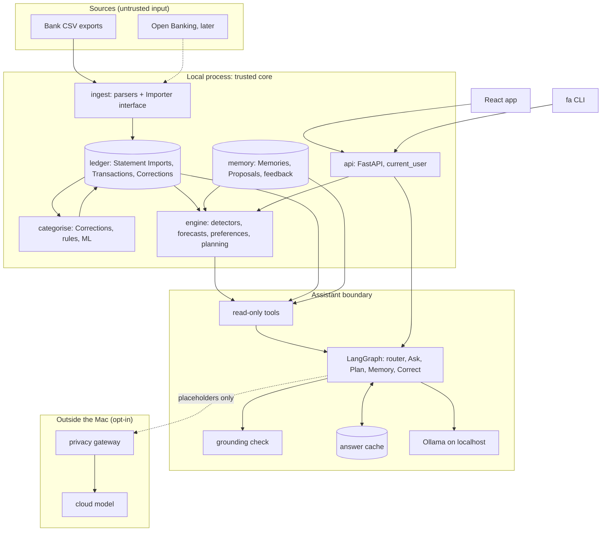

# Architecture

Status: draft for review. Vocabulary follows `GLOSSARY.md`; decisions live in `docs/adr/`.

## Shape

One Python application (a modular monolith), one encrypted SQLite file, one FastAPI process bound to `127.0.0.1`, serving both the API and the built React app. No microservices, queues, Redis or Docker. The `fa` command starts it and opens the dashboard.

Two systems sit at the centre (ADR 0007):

- **Intelligence Engine**: deterministic Python, no LLM. Detectors, forecasts, preference models, ranking, allocation optimiser. Produces Insights and Allocation Plans.
- **Assistant**: one LangGraph graph (ADR 0008). Interprets requests, calls read-only tools, explains. Never computes a figure.



## Modules

All under `src/finance_agent/`. Each module exposes a small typed interface (Pydantic models in, Pydantic models out) and is tested through it.

| Module | Owns | Depends on |
| --- | --- | --- |
| `storage` | The single connection factory (SQLCipher switch, ADR 0002), migrations (Alembic), the data-access layer that scopes every query by `user_id` | nothing |
| `ingest` | One parser per Bank, the `Importer` interface, duplicate detection (ADR 0006), account-number masking | `storage` |
| `ledger` | Transactions, Corrections overlay (ADR 0001), Kinds, Transfers, reconciliation, FX conversion with provenance | `storage` |
| `categorise` | Taxonomy (versioned), Merchant normalisation, the Corrections → rules → ML chain (ADR 0005), Review Queue | `ledger` |
| `engine` | Personal baselines, detectors, forecasts, Insight ranking, preference models, Allocation Plans, model registry | `ledger`, `categorise`, `memory` |
| `memory` | Memories, Proposals, feedback, retention | `storage` |
| `assistant` | The LangGraph graph, tool allowlist, grounding check, answer cache (ADR 0010), `ChatModel` interface and adapters | `engine`, `ledger` (read-only views), `memory` |
| `gateway` | Placeholder substitution, field allowlist, payload log, cost meter (ADR 0011, ADR 0012). No database access. | nothing except the payload it is handed |
| `api` | FastAPI routes, `current_user`, OpenAPI schema | all of the above |
| `cli` | The `fa` command | `api` (in-process) |

Dependency direction is enforced by an import-linter check in CI: nothing imports `assistant` except `api`, and `gateway` imports nothing from the core.

## How data moves

1. **Import.** `fa import lloyds.csv` stores the file as an encrypted Statement Import, unchanged. The Lloyds parser converts rows to Transactions in their original currency, masks the account number to `••••1234`, rejects malformed rows with line numbers, and skips rows already in the Ledger.
2. **Reconcile.** The Bank's running balance is checked against the Ledger; a difference becomes a Reconciliation Gap. Only completed Transactions count.
3. **Classify.** Each Transaction gets a Kind, then (for Spending and Refund) a Merchant and Category from Corrections, rules or ML, with a confidence and its source. Low confidence goes to the Review Queue.
4. **Analyse.** The Engine recomputes baselines, detectors and forecasts after each import, producing Insights with £ impact, confidence and evidence links.
5. **Present.** The API serves aggregates to the React app and the CLI.
6. **Converse.** The Assistant routes a question to a sub-graph, calls tools that return aggregates and Insights (at most 20 rows, evidence IDs attached), runs the grounding check, and replies. Any change it suggests is a Proposal that waits for a confirm click.

## Database: core entities

Every table has `user_id`. Money is stored as integer minor units plus an ISO currency code, and handled as `Decimal` in Python.

| Entity | Key fields |
| --- | --- |
| `user` | id, created_at |
| `bank` | id, name |
| `account` | id, user_id, bank_id, name, kind (current, savings, credit, pot), masked_number, currency |
| `statement_import` | id, user_id, account_id, source (csv, open_banking), file_hash, encrypted_blob, imported_at |
| `transaction` | id, user_id, account_id, posted_on, description, amount_minor, currency, running_balance_minor, status (pending, completed, reverted), dedupe_key |
| `transaction_source` | transaction_id, statement_import_id, row_number (one Transaction can appear in many imports) |
| `fx_conversion` | transaction_id, rate, gbp_minor, basis (bank-derived, estimated, unconverted), rate_source, rate_date |
| `merchant` | id, user_id, name, default_category_id |
| `category` | id, parent_id, name, taxonomy_version, archived_at |
| `correction` | id, user_id, transaction_id, field, new_value, origin (ui, chat), created_at, superseded_by |
| `categorisation` | transaction_id, category_id, kind, source (correction, rule, model), confidence, model_version |
| `transfer_link` | from_transaction_id, to_transaction_id, confidence, confirmed |
| `reconciliation_gap` | account_id, as_of, bank_balance_minor, ledger_balance_minor |
| `insight` | id, user_id, type, impact_minor, confidence, relevance, evidence (JSON of ids), created_at, status |
| `feedback` | insight_id or transaction_id, signal (accept, dismiss, worth_it, regret, pairwise), created_at |
| `memory` | id, user_id, type (preference, goal, constraint), text, tags, provenance (turn id, quote, date), review_on, status |
| `proposal` | id, user_id, kind (memory, correction), payload, status, created_at, decided_at |
| `model_version` | id, component, version, metrics, live_from, live_to, shadow |
| `answer_cache` | key (intent, tool calls, ledger_version), reply, created_at |
| `assistant_trace` | turn id, model, prompt_version, tool calls, grounding result (redacted) |
| `gateway_payload` | id, conversation_id, payload, cost, sent_at |

`ledger_version` is a counter bumped by any import or Correction; caches and derived tables key off it.

## Multi-user seams (ADR 0003)

`user_id` everywhere, one data-access layer, Alembic migrations kept Postgres-compatible, one `current_user` dependency (returns the local user until the demo milestone), and the `ChatModel` interface. Nothing else is built for multiple users.

## Repository layout

```
/
├── AGENTS.md, CLAUDE.md, GLOSSARY.md, README.md
├── pyproject.toml, uv.lock
├── src/finance_agent/
│   ├── storage/  ingest/  ledger/  categorise/  engine/
│   ├── memory/  assistant/  gateway/  api/  cli/
├── tests/
│   ├── unit/  property/  integration/
│   └── fixtures/synthetic/        # the only place CSV fixtures may live
├── evals/
│   ├── datasets/                  # synthetic only
│   ├── harness/                   # model and agent benchmarks
│   └── results/                   # committed synthetic results
├── web/                           # Vite + React + TS + Tailwind + shadcn
├── scripts/                       # CI checks (fixture guard, egress test)
└── docs/
    ├── ARCHITECTURE.md  FRONTEND.md  THREAT_MODEL.md  DATA_POLICY.md
    ├── AI_DESIGN.md  ML_EVALUATIONS.md  ROADMAP.md
    ├── adr/  agents/  design/
```

## Extension points

- **Open Banking**: a new `Importer` (Enable Banking first, after a prototype). Its rows merge with CSV rows by dedupe key.
- **Daily sync**: a `launchd` job calling `fa sync`; nothing in the core changes.
- **Hosted / mobile**: Postgres via the same migrations, real `current_user`, the React app is already responsive. Needs its own ADR first.
