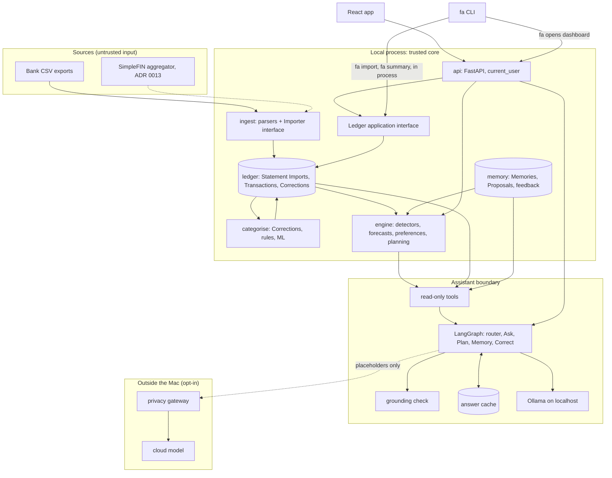

# Architecture

Status: draft for review. Vocabulary follows `GLOSSARY.md`; decisions live in `docs/adr/`.

## Shape

One Python application (a modular monolith), one encrypted SQLite file, one FastAPI process bound to `127.0.0.1`, serving both the API and the built React app. No microservices, queues, Redis or Docker. The `fa` command starts it and opens the dashboard.

Two systems sit at the centre (ADR 0007):

- **Intelligence Engine**: deterministic Python, no LLM. Detectors, forecasts, preference models, ranking, allocation optimiser. Produces Insights and Allocation Plans.
- **Assistant**: one LangGraph graph (ADR 0008). Interprets requests, calls read-only tools, explains. Never computes a figure.



## Modules

All under `src/finance_agent/`. Each module exposes a small typed interface (Pydantic models in, Pydantic models out) and is tested through it.

| Module | Owns | Depends on |
| --- | --- | --- |
| `storage` | The single connection factory (SQLCipher switch, ADR 0002), migrations (Alembic), the data-access layer that scopes every query by `user_id`, and `storage.backup`: encrypted copies to a registered drive, their manifest and retention, and restore (#95) | nothing |
| `ingest` | One parser per Bank, the `Importer` interface, account-number masking, and `ingest.simplefin`: the read-only SimpleFIN client, the only module that may import a network client, besides `cli.launcher`'s probe of our own server on 127.0.0.1 and `assistant.ollama` on localhost:11434 (ADR 0013, `tests/test_network_boundary.py`). Untrusted input: it touches neither the database nor the Ledger | nothing |
| `ledger` | Transactions, duplicate detection (ADR 0006), Corrections overlay (ADR 0001), Kinds, Transfers, reconciliation, FX conversion with provenance, and `ledger.review`: the Review Queue, whose answers are Corrections and registry decisions the Ledger owns (#110); a later scorer from `categorise` is passed in | `storage`, `ingest` |
| `categorise` | Taxonomy (versioned; the data is in `ledger.taxonomy` so the Ledger can show old Corrections in current names), Merchant normalisation, the Corrections → rules → ML chain (ADR 0005). `categorise.embedding` (#113): `OllamaEmbedder` (nomic-embed-text, `http.client` to `localhost:11434` only, `keep_alive` 1m) and `TrigramEmbedder` (the stand-in for tests and CI); vectors are int16, so no float enters `categorise` | `ledger`, `storage` (its own derived tables) |
| `engine` | Personal baselines, detectors, forecasts, Insight ranking, preference models, Allocation Plans, model registry. `engine.forecast` (#149) fits ETS with `statsmodels` (with its `scipy`, `numpy` and `pandas`): the standard ETS with prediction intervals, not worth re-implementing. It is the one module outside the money rule allowed to use `float`, inside the model fit only; every output is rounded to integer pence (`tests/test_no_float.py`) | `ledger`, `categorise` (read-only: recurring detection; `categorise` never imports `engine`, import-linter contract), `memory` |
| `memory` | Memories, Proposals, feedback, retention. Today in `ledger.proposals` (#138), because confirming a Correction Proposal must go through the Ledger's own Correction, Split and note paths; propose validates by running that confirm path in a savepoint that is always rolled back | `storage`, `ledger` |
| `assistant` | The LangGraph graph (`langgraph` pinned; LangSmith tracing forced off on import, ADR 0008), tool allowlist, grounding check, answer cache (ADR 0010), and the `ChatModel` interface with `FakeChatModel` (scripted, for tests and CI) and `OllamaChatModel` (`http.client` to `localhost:11434` only: any other host, redirect or proxy is refused; malformed tool calls are rejected) (#135). Graph checkpoints are kept through `ledger.conversation` (rows in the encrypted database) and written on the connection's own thread (#139). | `engine`, `ledger` (read-only views), `memory` (propose and read; confirm and reject run only on the user's decision, through the API). Never `storage`, `ingest`, `api` or `cli` directly (import-linter contract) |
| `gateway` | Placeholder substitution, field allowlist, payload log, cost meter (ADR 0011, ADR 0013). No database access. | nothing except the payload it is handed |
| `api` | FastAPI routes, `current_user`, OpenAPI schema | all of the above |
| `cli` | The `fa` command. `fa import`, `fa summary`, `fa connect` / `disconnect` / `sync` (SimpleFIN, ADR 0013/0014) and `fa watch` (watched-folder import) call the Ledger interface in process; `fa backup` / `fa restore` call `storage.backup`; `fa forget-embeddings` calls `categorise.embedding.forget` (the scheduled sync backs up after it succeeds); `fa sync --install`, `fa watch install` and `fa backup setup` write `launchd` agents; `fa` (open dashboard) talks to the running server | `ledger`, `categorise`, `storage` (opening the database, the Keychain), `ingest.simplefin` (fetching), `identity` (in-process); `api` only over HTTP |

Dependency direction is enforced by an import-linter check in CI: nothing imports `assistant` except `api`, and `gateway` imports nothing from the core.

## Ledger application interface

The main seam of the core (spec #1). It is the in-process interface that the CLI, the API and the tests all call. The API is a thin adapter over it, so no figure is computed in a route handler. It takes a `user_id` and a connection from the `storage` factory, and it never returns floats.

Operations:

- **Import** Statement Import file(s) and return an import report: rows added, rows already known, rejected rows with line numbers, and the Accounts affected.
- **List Accounts** with the Bank-reported balance, the Ledger-implied balance and any open Reconciliation Gaps.
- **Summarise a month**: money in, money out, net, and the Reconciliation Gaps touching that month.
- **Spending by Category** for a month, with drill-down to subcategories and Merchants.
- **List and search Transactions** with filters.
- **Record a Correction** for one Transaction, or for every Transaction with a Merchant.

## How data moves

1. **Import.** `fa import lloyds.csv` stores the file as an encrypted Statement Import, unchanged. The Lloyds parser converts rows to Transactions in their original currency, masks the account number to `••••1234`, rejects malformed rows with line numbers, and skips rows already in the Ledger.
2. **Reconcile.** The Bank's running balance is checked against the Ledger; a difference becomes a Reconciliation Gap. Only completed Transactions count.
3. **Classify.** Each Transaction gets a Kind, then (for Spending and Refund) a Merchant and Category from Corrections, rules or ML, with a confidence and its source. Low confidence goes to the Review Queue.
4. **Analyse.** The Engine recomputes baselines, detectors and forecasts after each import, producing Insights with £ impact, confidence and evidence links.
5. **Present.** The API serves aggregates to the React app. The CLI reads the same aggregates in process through the Ledger interface, so the figures match.
6. **Converse.** The Assistant routes a question to a sub-graph, calls tools that return aggregates and Insights (at most 20 rows, evidence IDs attached), runs the grounding check, and replies. Any change it suggests is a Proposal that waits for a confirm click.

## Database: core entities

Every table has `user_id`. Money is stored as integer minor units plus an ISO currency code, and handled as `Decimal` in Python.

| Entity | Key fields |
| --- | --- |
| `user` | id, created_at |
| `bank` | id, name |
| `account` | id, user_id, bank_id, name, kind (current, savings, credit, pot), masked_number, currency |
| `statement_import` | id, user_id, account_id, source (csv, open_banking), file_hash, encrypted_blob, imported_at |
| `transaction` | id, user_id, account_id, posted_on, description, amount_minor, currency, running_balance_minor, status (pending, completed, reverted), dedupe_key |
| `transaction_source` | transaction_id, statement_import_id, row_number (one Transaction can appear in many imports) |
| `fx_rate` | id, user_id, currency, rate (Decimal string, GBP per unit), rate_on, created_at: rates the user entered (#156). Conversions are derived on read, each with its rate's source and date; `transaction.gbp_minor` holds a Bank's own GBP amount when its export gives one |
| `merchant` | id, user_id, name, default_category_id |
| `category` | id, parent_id, name, taxonomy_version, archived_at |
| `correction` | id, user_id, transaction_id, field, new_value, origin (ui, chat), created_at, superseded_by |
| `categorisation` | transaction_id, category_id, kind, source (correction, rule, model), confidence, model_version |
| `merchant_embedding` | user_id, merchant_id, model, dims, vector (int16): one local-model vector per Merchant (#113). Cascades from `merchant`; a trigger on `transaction` delete drops vectors of Merchants no Transaction names any more |
| `transfer_link` | from_transaction_id, to_transaction_id, confidence, confirmed |
| `reconciliation_gap` | account_id, from_date, to_date, amount_minor (Bank minus Ledger; rebuilt after every import) |
| `insight` | id, user_id, type, impact_minor, confidence, relevance, evidence (JSON of ids), created_at, status |
| `feedback` | insight_id or transaction_id, signal (accept, dismiss, worth_it, regret, pairwise), created_at |
| `memory` | id, user_id, type (preference, goal, constraint), text, tags, provenance (turn id, quote, date), review_on, status |
| `proposal` | id, user_id, kind (memory, correction), payload, status, created_at, decided_at |
| `model_version` | id, component, version, metrics, live_from, live_to, shadow |
| `answer_cache` | key (intent, tool calls, ledger_version), reply, created_at |
| `assistant_trace` | turn id, model, prompt_version, tool calls, grounding result (redacted) |
| `gateway_payload` | id, conversation_id, payload, cost, sent_at |

`ledger_version` is a counter bumped by any import or Correction; caches and derived tables key off it.

## Multi-user seams (ADR 0003)

`user_id` everywhere, one data-access layer, Alembic migrations kept Postgres-compatible, one `current_user` dependency (returns the local user until the demo milestone), and the `ChatModel` interface. Nothing else is built for multiple users.

## Repository layout

```
/
├── AGENTS.md, CLAUDE.md, GLOSSARY.md, README.md
├── pyproject.toml, uv.lock
├── src/finance_agent/
│   ├── storage/  ingest/  ledger/  categorise/  engine/
│   ├── memory/  assistant/  gateway/  api/  cli/
├── tests/
│   ├── unit/  property/  integration/
│   └── fixtures/synthetic/        # the only place CSV fixtures may live
├── evals/                         # the harnesses (categoriser.py, ...), gate.py, metrics.py
│   ├── datasets/                  # synthetic only
│   └── results/                   # committed synthetic results
├── web/                           # Vite + React + TS + Tailwind + shadcn
├── scripts/                       # CI checks (fixture guard, egress test)
└── docs/
    ├── ARCHITECTURE.md  FRONTEND.md  THREAT_MODEL.md  DATA_POLICY.md
    ├── AI_DESIGN.md  ML_EVALUATIONS.md  ROADMAP.md
    ├── adr/  agents/  design/
```

## Extension points

- **Bank sync**: one read-only SimpleFIN aggregator (ADR 0013). Synced rows are identified by provider transaction ID and matched to CSV rows (ADR 0014); a daily `launchd` job runs `fa sync --notify`.
- **Hosted / mobile**: Postgres via the same migrations, real `current_user`, the React app is already responsive. Needs its own ADR first.
